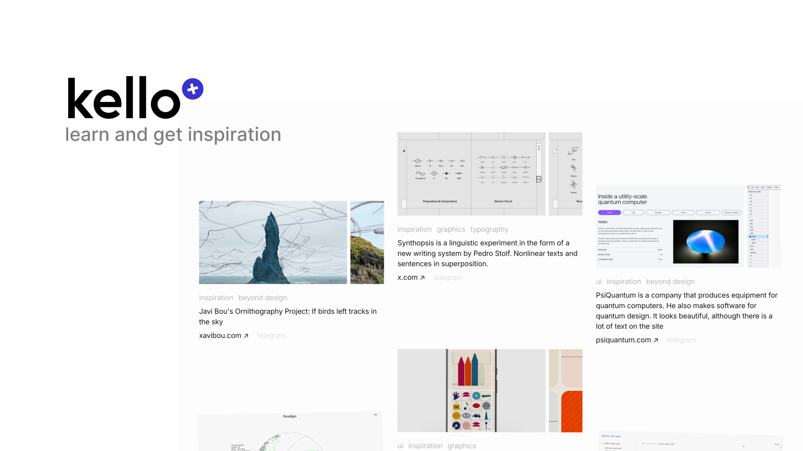

# kello

knowledge + inspo collected [by qurle](https://qurle.net). live on [kello.press](https://kello.press) and [kello.qurle.net](https://kello.qurle.net)

[]([https://](https://kello.qurle.net))

A static Astro site that mirrors the Telegram channel [the\_kello](https://t.me/the_kello) in English, with the original Russian at `/ru`. A GitHub Action pulls new posts every 12 hours, and Vercel rebuilds the site. How it works is in [AGENTS.md](AGENTS.md).

```sh
npm run dev     # dev server
npm run build   # production build
npm run sync    # pull new posts from Telegram
```

## Your own channel

Any public channel works: one whose posts open at `t.me/s/<username>`. Posts are translated by Google Translate, from and to the languages you set, or not at all.

1. Fork the repo and run `npm install`.
2. In `kello.config.ts`, set `site` (title, url, subtitle) and `channel.username`. Set `translate`: `from` your channel's language, `to` the site's main one, or `enable: false` for the original only. Replace the `tags` table with your channel's hashtags (`hashtag`, its URL `slug`, and an optional translated `label`).
3. Clear the content: delete `src/data/posts/*.json` and `public/media/*`, and empty the `overrides` object in `src/data/overrides.ts`.
4. Run `npm run sync -- --full` to fetch the whole channel, then commit and push.
5. Import the repo on Vercel; the Astro preset needs no settings. The sync workflow then runs every 12 hours. Run it once from the Actions tab to check that it can push.
6. Optional: full-size photos through a Telegram bot. Setup is in [AGENTS.md](AGENTS.md#full-size-photos).

Swap `public/favicon.svg` and `public/og.png` (1200×630) for your own.
